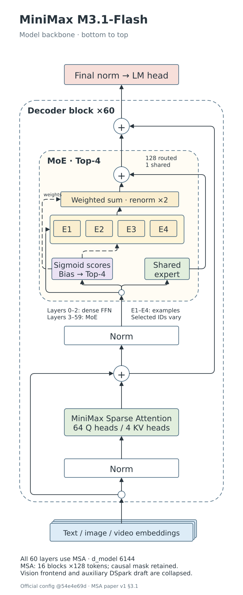
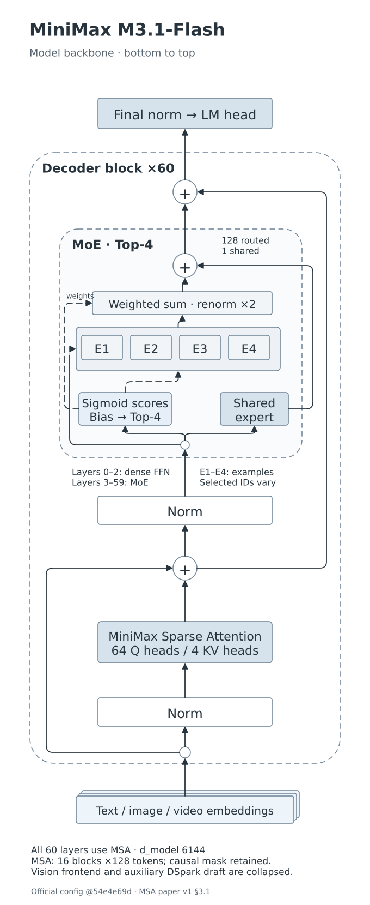

# infra-io-generator

面向论文、模型和核心机制的可编辑技术架构图 Skill 与生成、验证工具。

代码仓库：<https://github.com/grandolantow/infra-io-generator>。

从技术事实出发，选择结构模板，生成原生 draw.io，由实际绘图引擎导出，再用 Inkscape 精修。复杂公式或 LaTeX 集成按需使用 TikZ。

当前整理版：**v0.10.5**（一个入口、两个独立来源的 Skill）。

[Skill 完整性核对清单](docs/skill-inventory.md) · [外部 Skill 收藏](docs/external-skills.md) · [PPT 主流程设计存档](docs/ppt-workflow-design.md)。此仓库包含绘图 Skill 的完整代码；PPT 主流程设计、外部 draw.io/PlantUML 收藏以及其他工程 Skill 的恢复状态分别登记，不将它们冒充已实现模块。

## 高层绘图委托与低层渲染

PPT/报告调用方提交内容 brief（事实、受众、用途、主题及展示约束），由独立绘图 agent 消费本仓 Skill 完成参考读取、语义与组件设计、实际渲染、参考对照和修订。不得先在主 Skill 设计完整源图，再把 renderer 调用称为完整绘图能力。

```bash
python tools/prepare_diagram_brief.py --input brief.json --out-dir handoff
# Host 实际派发 handoff/agent-task.md 给独立绘图 agent；脚本不执行 LLM 设计。
python tools/check_diagram_delivery.py --brief handoff/brief.json \
  --delivery delivery/diagram-delivery.json --root delivery --output contract-qa.json
```

输入/交付 schema 位于 `contracts/`，完整工作流见 [independent-workflow.md](skills/technical-architecture-diagrams/references/independent-workflow.md)。交付保留参考文件、selector 候选及实际应用、设计决定、真实渲染与视觉复核证据。散列及契约通过只证明记录和文件一致，不证明阅读发生、技术正确或美观；缺独立委托能力时明确 blocked。默认 3–4 个实质不同编号方案（`variant_count` 默认 3），每版保留可编辑源与 QA，全部归档一份编号 PDF；调用方显式选一版嵌 HTML，并决定配套解释。PDF 页数和可提取编号使用 Poppler 核验，不代表视觉质量通过。空间与主题允许绘图侧合理调整，不能先固定几何。低级 renderer API 保留用于绘图 agent 的生成/修订环节。

## 成图示例

| 清彩论文（默认） | 素雅灰蓝（可选） |
| --- | --- |
|  |  |

[下载后打开双配色预览](examples/minimax-m31/preview.html)。HTML 自包含，支持切换和原生源文件下载；GitHub 文件页不会执行 HTML，需下载后用浏览器打开。

## 设计约定

- **模型布局默认倾向**：竖向主干＋侧边机制展开，先设计图再适配 PPT；横版不自动横排。可按任务理由偏离并记录实际图 QA，report 类别按自身关系布局，不机械竖化。路由 `parts[].layout_preference` 仅表达偏好，不能替代视觉验收。
- **事实优先**：来源、版本、运算、数据流和残差端点可追溯。
- **图形比例由内容决定**：模型可采用竖向主干，右侧展开可选；机制对照按真实关系安排，不强制三栏或 16:9。
- **draw.io 管结构，Inkscape 管精修**：交付可编辑对象和文字；TikZ 按需启用。三者不自动双向同步。
- **按语义目标路由**：模型主干/模块结构走 model；通信、内存、调度、量化、性能等机制解释走 report；混合任务拆分并共享事实。
- **分支默认配色**：model 一律默认 `paper-clear`；report 的 PPT 默认 `huawei-plain`，论文/未指定默认 `paper-vivid`。显式 palette 和颜色覆盖优先；换色不改事实与布局。
- **Agent 负责理解与设计**：样例构建器是特定场景模板，不是自动理解任意论文的通用编译器。

## 安装给 Agent

把 `skills/` 下 **两个目录** `technical-architecture-diagrams/` 与 `technical-diagram-options/` 一起放入 Agent 的 skills 目录，保持同级。统一入口位于前者；也可直接调用后者。若已有同名 Skill，先比较并备份本地修改。

然后使用：

> 使用 $technical-architecture-diagrams，依据给定论文与版本绘制模型架构图。先核对事实，再选择图形结构；默认清彩论文配色，保留 draw.io 与 SVG，并实际渲染检查。

也可以显式要求「素雅灰蓝」「只画竖向主干」或「增加可选局部展开」。

## 统一入口用法

> 使用 $technical-architecture-diagrams，在 PPT 里讲清 PCP 的通信与 KV cache 映射。走技术报告分支，默认朴素主配色，保留可编辑源。

> 使用 $technical-architecture-diagrams，画模型完整主干和 MoE block 结构，放入 PPT。模型分支仍用清彩论文配色。

> 画模型整体架构，再单独解释通信时序。两张图共用事实与术语；统一使用 blue-neutral。

```sh
python skills/technical-architecture-diagrams/scripts/route_request.py --request 'PCP communication timeline' --target ppt
python skills/technical-architecture-diagrams/scripts/route_request.py --request '模型整体架构与通信时序' --intent mixed --palette blue-neutral
python -m unittest discover -s tests -p test_routing.py -v
```

这是 Agent 的语义工作流加保守路由辅助，不是自然语言到任意图的全自动编译器。`--intent auto` 仅产生关键词建议；“画 Attention”、否定或引用等歧义应语义复核后显式给 intent。PPT/论文不决定图类型。原 `resolve_palette.py` 的 auto 保持模型分支兼容行为；报告须采用路由输出的显式 palette，或直接使用输出 tokens。

[分支与来源](skills/technical-architecture-diagrams/references/integration-provenance.md) · [技术报告规范](skills/technical-architecture-diagrams/references/technical-report.md)。安装时复制两个完整同级目录；仓库更新不等于已覆盖你个人安装的 Skill。

## 两个独立实现与报告执行

模型架构使用 `technical-architecture-diagrams` 的 draw.io/Inkscape/TikZ 路线；技术报告使用独立 `technical-diagram-options` 的结构选择、规则卡、公开来源索引、语义/几何 IR 与 SVG/draw.io 导出器。两者共享入口与可调配色，但不共享一个固定图模板。

[报告包文件清单](reports/report-skill-files.json)。来源索引仅包含公开引用与必要规则关联，不包含 source artwork 或私人评论。

```sh
# 原报告 Skill 的真实接口；task/diagram 为结构化 JSON，不是自然语言自动编译
mkdir -p build/report
python skills/technical-diagram-options/scripts/select_options.py skills/technical-diagram-options/examples/toy-mapping.task.json --out build/report/options.json
python skills/technical-diagram-options/scripts/diagram_tool.py check skills/technical-diagram-options/examples/toy-mapping.diagram.json
python skills/technical-diagram-options/scripts/diagram_tool.py render skills/technical-diagram-options/examples/toy-mapping.diagram.json --out-dir build/report/figures
python skills/technical-diagram-options/scripts/check_package.py
python -m unittest discover -s skills/technical-diagram-options/tests -v
```

例子是虚构 toy mapping，只验证执行契约；不是新的论文成图或模型能力评测。报告 palette tokens 是外部 overlay，Agent 按角色写入 diagram IR 的 styles 后生成；导出器不自动理解自然语言或替换配色。原始图库/collector manifests 不随代码发布；公开版只校验引用关系，`--corpus-root`/`--gallery-root` 明确拒绝执行，不能据此假称资产完整性通过。

## 绘图语言规范

默认 `diagram-en-prose-zh`：图中的功能标签、短注释、箭头说明和短图例用英文；能脱离图独立阅读的长段解释用中文；术语、缩写、模型名、公式和变量保留原英文/符号。按语义角色，不按框内外、容器位置或机械字数划分。图周边的说明也属于绘图产物和 QA。

两套 Skill 共用 [语言规范](skills/technical-architecture-diagrams/references/text-language.md) 与显式 `text_role`。报告生成器在指定 profile 时消费共享检查器，原生 SVG/draw.io 保留角色；缺失角色不得被当成已合规。旧无 profile 输入仅兼容旧生成，语言检查为 not_run。PPT 只透传 profile、消费 QA，不复制规则。

```sh
python skills/technical-architecture-diagrams/scripts/check_language.py --input skills/technical-diagram-options/examples/toy-mapping.language.diagram.json --format report --profile diagram-en-prose-zh --output build/language-qa.json
```

检查器只做角色合同和有限字符检查。`contract_status=pass` 仍为 `status=needs_review`，不代替语义和实际渲染审查；不会自动翻译技术内容。

## 本地准备

基础命令需要 Python 3.10+。原生渲染还需要 Node.js 20+、Playwright 和 Chromium；精修使用 Inkscape CLI。TikZ 为可选后端，精修校准 TeX 使用 XeLaTeX、TikZ、fontspec 与 DejaVu 字体。

```sh
python -m venv .venv
# 激活虚拟环境后：
python -m pip install -r requirements.txt
npm install
npx playwright install chromium
```

Inkscape 需通过系统安装，并确保 `inkscape --version` 可运行。Node/Python 依赖只按使用范围加载；基础检查不需要浏览器、Inkscape 或 TeX。

## 快速验证

在仓库根目录执行：

```sh
# 配色单测、结构契约、golden 语义及源码路径检查
python tools/check.py

# 原生导出 + Inkscape 精修（Chromium 默认使用 Playwright 安装的版本）
python tools/render_example.py --example minimax --palette blue-neutral --out build/minimax-plain

# 同一个模板生成 Attention Residuals 校准图并实际渲染
python tools/render_example.py --example attnres --out build/attnres
```

也可以指定已有浏览器 `--chrome /path/to/chrome`。环境集成可设置 `PLAYWRIGHT_MODULE`、`CHROME_BINARY`；普通本地安装无需这些变量。输出写入 `build/` 或显式目录，不修改已安装 Skill。

底层调用方法见 [运行说明](docs/runtime.md)。

## 目录

| 路径 | 用途 |
| --- | --- |
| `skills/technical-architecture-diagrams/` | 可安装的 Skill、规则、配色、脚本及校准模板 |
| `examples/minimax-m31/` | 竖向主干、独立 MSA 展开、双配色、事实与可编辑源 |
| `tools/`、`tests/` | 仓库检查、样例渲染和画布尺寸回归 |
| `third_party/drawio/` | 已核验的官方 Graph bundle、SHA pin 与上游许可证 |
| `docs/` | 架构、运行、评测边界、Skill 清单、PPT 主流程设计及 v0.4 原包存档 |
| `reports/` | 本次整理实际执行的检查摘要 |

## 独立复现结果

[独立 MiniMax 复现：离线 HTML](examples/independent-minimax/minimax-m31-flash.html) · [运行和问题记录](examples/independent-minimax/ACTUAL-RESULTS.md)。

另起上下文，仅提供 Skill、固定事实和原始配置/代码，不提供之前的 MiniMax 成图或布局。重新生成竖向主干、MSA、MoE 三图及两套配色。首版存在文字溢出、连线穿过 bias 框和折角问题，已保留并修订。最后在全新输出目录完整运行，六份母版与正式版本逐字节一致。该例验证执行与修订闭环；视觉仍偏流程框式，未达到用户 golden 的结论不变，也不是新论文留出泛化测评。

## 验证范围

40 条人工评价是风格依据；100 图索引是参考检索集，没有训练模型权重。三轮十题属于开发与回归，不能称独立泛化测评。当前可复现检查覆盖来源结构、golden 候选集合、配色不改变结构、任意页面尺寸与实际 Graph 导出；几何通过不等于用户认可或技术语义全部正确。

完整 draw.io EditorUi/Desktop、PPTX 对象编辑和宿主 HTML PPT 工作流集成仍需独立测试。详见 [评测与边界](docs/evaluation.md)。

第三方组件说明见 [THIRD_PARTY_NOTICES.md](THIRD_PARTY_NOTICES.md)。当前未替项目作者选择开源许可证，正式发布前由仓库所有者决定。

### 可选模型 TikZ 执行

对已核验、任务作者编写的自包含 TeX，使用 `tools/render_model_tikz.py` 实际生成 PDF/SVG/PNG 和运行 QA。保留 TeX 为可编辑源；它不是自动理解模型的生成器，也不是任意 TeX 沙箱。[依赖与边界](skills/technical-architecture-diagrams/references/tikz-runtime.md)。
